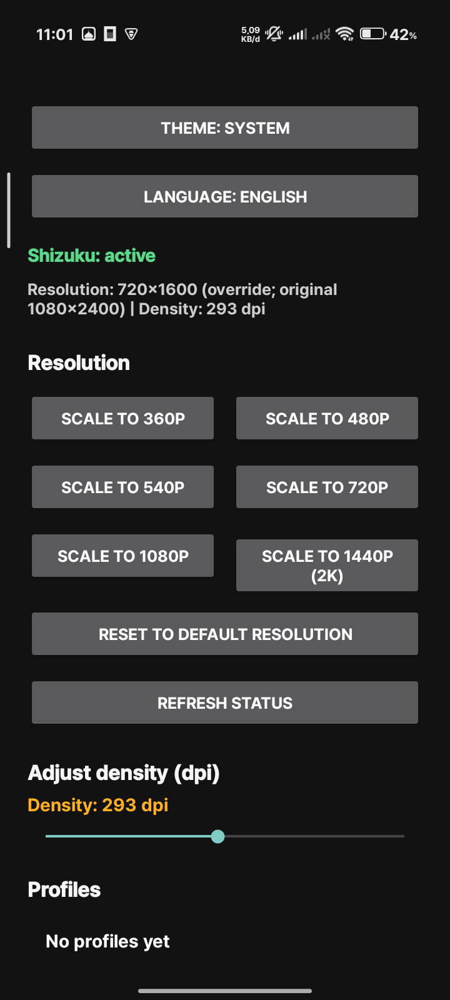

# Redensity

**English** · [Bahasa Indonesia](#bahasa-indonesia)

Redensity is a free, open-source Android app to **scale down your screen resolution and density** (dpi) — e.g. to 720p / 540p — **without root**, using **Shizuku**. Perfect for older phones, saving battery, fixing laggy UIs, or making games/apps render lighter.

Every change can be **previewed for 15 seconds** — if it doesn't look right, the screen reverts automatically.



## Features
- No root required (works through [Shizuku](https://github.com/RikkaApps/Shizuku), or via ADB from a PC)
- Every device: resolution and aspect are read from the phone itself — 16:9, 20:9, 4:3, tablets, anything with `wm` support
- **Ask-then-apply + 15-second trial** like Windows display confirmation: confirm before applying, then a countdown dialog (Keep/Revert) - automatic revert if ignored
- One-tap presets: **360p / 480p / 540p / 720p / 1080p / 1440p** (2K asks for confirmation first — not recommended for gaming, may cause lag)
- Density slider (120–480 dpi)
- **Profiles**: your own saved profiles (renameable, deletable) - the 2K button and any profile above 1080p ask for confirmation
- **Light / Dark theme** (system, light, or dark)
- **Bahasa Indonesia & English** (system, manual switch)
- **PC control via ADB**: apply settings from a computer over USB or wireless debugging (see [docs/PC-CONTROL.md](docs/PC-CONTROL.md)) — also over QR pairing with RedensityDesktop / ADBMOD
- **Reset** button to return to factory resolution any time

## Requirements
- Android 8.0+ (API 26)
- [Shizuku](https://github.com/RikkaApps/Shizuku) running on the phone (via wireless debugging or `adb`)
- Wireless debugging re-enables after every reboot — this is an Android limitation, not the app's

## Install
1. Download `Redensity-v1.0.apk` from [Releases](../../releases).
2. Install (you may need to allow "install from unknown sources").
3. Install and start **Shizuku**.
4. Open Redensity → grant Shizuku access when asked.

## Usage
1. Tap a preset (**360p** … **1440p**) (or slide density).
2. A confirmation dialog appears at the current resolution - tap **APPLY**. Only then does the screen change - a countdown appears (15 s).
3. Tap **SAVE** to keep, or **REVERT** (or just wait) to go back.
4. **Reset to default resolution** any time.
5. **Profiles**: tap to apply, long-press to delete.
   "Save current settings as profile" stores your current size + density.
6. Theme / language buttons cycle: System → Dark → Light / System → Indonesia → English.

## Build from source
```
git clone <this repo>
cd Redensity
./gradlew assembleDebug     # or assembleRelease (needs release.keystore)
```
Needs JDK 17 + Android SDK (compileSdk 35). See `local.properties.example` for the release signing layout (never commit `release.keystore` — it's in `.gitignore`).

## Safety
Redensity only changes `wm size` / `wm density` — the same commands ADB shell uses. It can't brick your phone: revert any time in-app, or reboot (you may need Shizuku/`wm size reset` from a PC afterwards). Some ROMs may render oddly at low resolutions — that's what the 15 s trial is for.

---

# Bahasa Indonesia

Redensity adalah aplikasi Android **gratis dan open source** untuk **mengecilkan resolusi dan density layar** (mis. ke 720p / 540p) — **tanpa root**, lewat **Shizuku**. Cocok untuk HP lama, menghemat baterai, atau memperingan UI yang berat.

Setiap perubahan bisa dicoba dulu lewat **mode uji coba 15 detik** — kalau tidak cocok, tampilan kembali otomatis.

## Fitur
- Tanpa root (lewat [Shizuku](https://github.com/RikkaApps/Shizuku), atau via ADB dari PC)
- Semua perangkat: resolusi dan aspek dibaca dari HP itu sendiri (16:9, 20:9, 4:3, tablet, dll — dengan `wm`)
- **Tanya-dulu + uji coba 15 detik** ala konfirmasi resolusi di Windows: konfirmasi dulu sebelum diterapkan, lalu dialog hitung mundur (SIMPAN/KEMBALIKAN) - kembali otomatis kalau diabaikan
- Preset sekali ketuk: **360p / 480p / 540p / 720p / 1080p / 1440p** (2K meminta konfirmasi dulu — tidak disarankan untuk gaming, bisa ngelag)
- Slider density (120–480 dpi)
- **Profil**: profil buatan sendiri (bisa disimpan, diterapkan, dan dihapus) - tombol 2K dan profil di atas 1080p meminta konfirmasi
- **Mode terang / gelap** (sistem, terang, atau gelap)
- **Bahasa Indonesia & Inggris**
- **Kontrol dari PC via ADB**: langsung dari komputer lewat USB / wireless debugging (lihat [docs/PC-CONTROL.md](docs/PC-CONTROL.md)) — juga lewat QR pairing dengan RedensityDesktop / ADBMOD
- Tombol **Reset** kapan pun kembali ke setelan awal

## Persyaratan
- Android 8.0+ (API 26)
- [Shizuku](https://github.com/RikkaApps/Shizuku) berjalan di HP (wireless debugging atau `adb`)
- Wireless debugging perlu diaktifkan lagi setelah HP restart (keterbatasan Android, bukan app-nya)

## Instalasi
1. Unduh `Redensity-v1.0.apk` dari [Releases](../../releases).
2. Install (izinkan "install dari sumber tidak dikenal" bila diminta).
3. Install dan jalankan **Shizuku**.
4. Buka Redensity → izinkan akses Shizuku.

## Cara pakai
1. Ketuk preset (**360p** … **1440p**) (atau geser slider density).
2. Muncul dialog konfirmasi di resolusi saat ini - ketuk **TERAPKAN**. Baru setelah itu layar berubah - muncul hitung mundur 15 detik.
3. Ketuk **SIMPAN** untuk memakai, atau **KEMBALIKAN** (atau tunggu 15 detik) untuk kembali normal.
4. **Reset ke resolusi asli** kapan pun.
5. **Profil**: ketuk untuk menerapkan, tahan lama untuk menghapus profil buatan sendiri. "Simpan setelan sekarang sebagai profil" menyimpan resolusi + density saat ini.
6. Tombol Tema/Bahasa bergiliran: Sistem → Gelap → Terang / Sistem → Indonesia → English.

## Build dari source
```
git clone <repo this>
cd Redensity
./gradlew assembleDebug     # atau assembleRelease (butuh release.keystore)
```
Butuh JDK 17 + Android SDK (compileSdk 35). Lihat `local.properties.example`.

## Keamanan
Redensity hanya mengubah `wm size` / `wm density` — perintah yang sama dipakai ADB shell. Tidak bisa merusak HP: kembalikan kapan pun lewat app, atau restart (setelah restart mungkin perlu `wm size reset` via PC). Beberapa ROM mungkin tampil aneh pada resolusi rendah — makanya ada uji coba 15 detik.

## License
MIT — lihat [LICENSE](LICENSE).
